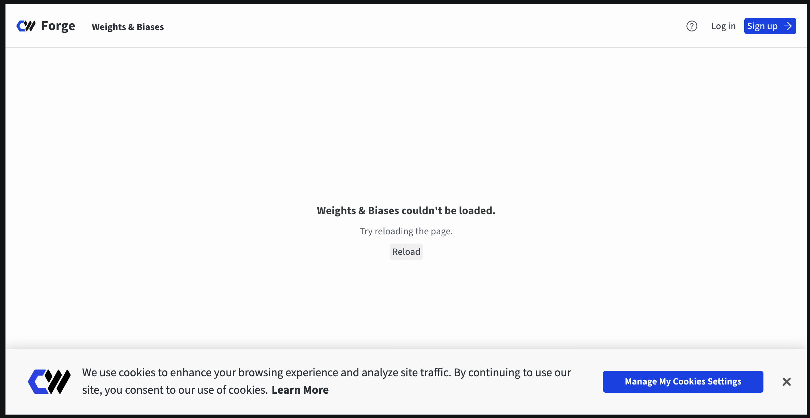
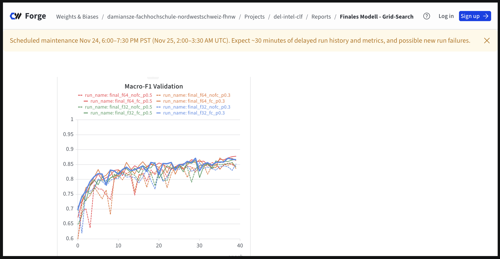

# Mini-Challenge Deep Learning

Bildklassifikation auf dem [Intel Image Classification Dataset](https://www.kaggle.com/datasets/puneet6060/intel-image-classification) mit einem CNN in PyTorch.

Der gesamte Bericht steht in [DEL_MC.ipynb](DEL_MC.ipynb):

1. **Etappe 1:** Basismodell, Tuning von Lernrate und Batchsize, Fehlerabschätzung mit 5-Fold-CV
2. **Etappe 2:** zehn Hypothesen zu Architektur, Regularisierung, BatchNorm, Initialisierung, Optimizer und Transfer Learning
3. **Finales Modell:** Kombination aus BatchNorm, Dropout und Augmentation, ausgewertet auf dem Testset

## Ergebnisse

| Modell | Epochen | Macro-F1 | Gemessen auf |
|---|---|---|---|
| Basismodell | 20 | 80.15 % ± 0.44 % | 5-Fold-CV |
| Finales Modell | 40 | 85.91 % ± 0.59 % | 5-Fold-CV |
| Finales Modell | 40 | 87.4 % | Testset (`seg_test`) |
| Eingefrorenes ResNet18 | 20 | 90.83 % ± 0.16 % | 5-Fold-CV |

Bei der CV ist der Mittelwert ± Standardfehler über die 5 Folds angegeben.

## Notebook ansehen

Alle Outputs sind im Notebook gespeichert, es muss nichts ausgeführt oder installiert werden.

Die Lernkurven sind als W&B-Reports eingebettet, die GitHub nicht anzeigt. Deshalb das Repository klonen und das Notebook lokal öffnen:

```bash
git clone https://github.com/damiansze/DEL_FS26.git
```

1. `DEL_MC.ipynb` öffnen. Eine Internetverbindung ist nötig, ein W&B-Konto nicht.
2. In jedem eingebetteten W&B-Fenster einmal auf **Reload** klicken, damit die Plots angezeigt werden.

| Vor dem Klick auf Reload | Danach |
|---|---|
|  |  |

## Notebook selbst ausführen

Nur nötig, wenn Zellen neu ausgeführt werden sollen.

Voraussetzungen: Python 3.13 und [uv](https://docs.astral.sh/uv/).

```bash
uv sync
```

Danach das Notebook öffnen und die Umgebung `.venv` als Kernel wählen.

**Daten:** Datensatz von Kaggle herunterladen und so entpacken:

```
data/Intel_Image_Classification/
├── seg_train/seg_train/<klasse>/*.jpg
├── seg_test/seg_test/<klasse>/*.jpg
└── seg_pred/seg_pred/*.jpg
```

**Weights & Biases:** Eine Datei `.env` mit `WANDB_API_KEY=...` anlegen. Die Läufe werden im Projekt `del-intel-clf` geloggt.

## Hinweise zum erneuten Ausführen

- Ein kompletter Durchlauf umfasst über 90 Trainingsläufe. Trainiert wurde auf einem Mac mit Apple Silicon (MPS).
- Die Auswertungszellen laden die Lernkurven über die W&B-API anhand fester Run-IDs. Dafür ist Zugriff auf das ursprüngliche W&B-Projekt nötig.
- Die Checkpoints des finalen Modells (`checkpoints/`) und die Daten (`data/`) sind nicht im Repository.
